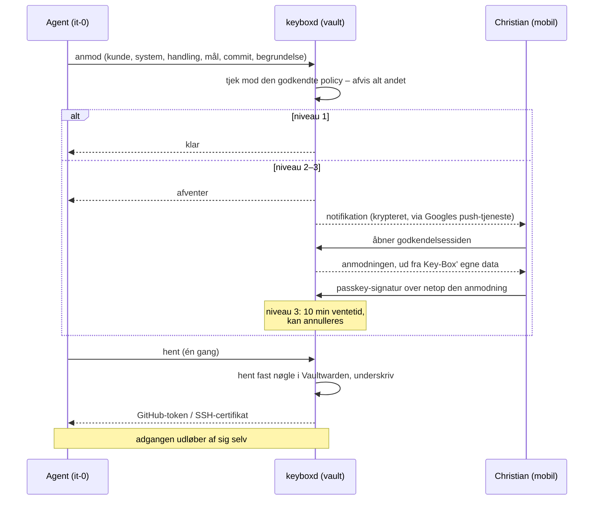

# Key-Box

> **In English:** Key-Box is a small credential broker for AI coding agents, written in Rust.
> Agents hold no standing access. They ask for one specific permission (customer, system,
> action, target, commit, reason), the request is checked against a signed-off policy, and
> higher-risk requests need a WebAuthn passkey approval from a phone, with a cancellable
> delay for the most sensitive actions. Key-Box then hands out a narrow, short-lived GitHub
> installation token or SSH certificate, fetched from Vaultwarden. It listens only on
> Tailscale, runs under a locked-down systemd unit, and logs every step.
> Workspace: `keyboxd` (daemon), `keybox-core` (request state machine), `keybox-policy`,
> `keybox-webauthn`, `keybox-api`, `keybox-log`. The rest of the docs are in Danish.

Nøgleboksen til IT Hjælp Nu's agenter. Agenterne har ingen adgange selv. De
beder Key-Box om én bestemt adgang, Christian godkender med passkey, og Key-Box
udleverer en smal adgang, der udløber af sig selv.

- Trusselsmodel og håndhævelse: [SECURITY.md](SECURITY.md)
- Installation: [docs/INSTALL.md](docs/INSTALL.md)
- GitHub App: [docs/GITHUB-APP.md](docs/GITHUB-APP.md)
- SSH-certifikater: [docs/SSH.md](docs/SSH.md)
- Afhængigheder: [docs/DEPENDENCIES.md](docs/DEPENDENCIES.md)

## Forløb



## Grænseflader

`keyboxd` er én dæmon med to adskilte indgange. Begge lytter kun på
Tailscale-adressen og kun for adresserne på hver sin liste.

**Agent-API** – TLS 1.3 med klientcertifikat pr. agent. Én JSON-linje ind, én ud.

| Kald | Virkning |
|---|---|
| `list` | Hvad agenten må bede om. |
| `request` | Opretter en anmodning. Afvises, hvis den ikke står i policyen. |
| `status` | Tilstanden for agentens egen anmodning. |
| `fetch` | Udleverer adgangen én gang. For SSH sendes agentens offentlige nøgle med. |
| `withdraw` | Agenten trækker sin egen anmodning tilbage. |

Agent-API'et kan ikke godkende noget.

**Godkendelsesside** – HTTPS med passkeys.

| Handling | Kræver |
|---|---|
| Se ventende anmodninger og policy-forslag | At kunne nå siden |
| Spørge, om noget er ændret (`/state`, så siden opdaterer sig selv) | At kunne nå siden |
| Afvise / annullere | Ingen passkey (kan kun lukke) |
| Godkende en anmodning | Passkey |
| Godkende en ny policy | Passkey |
| Nødstop og genstart | Passkey |
| Slå notifikationer til i en browser | Passkey |
| Slå notifikationer fra | Browserens egen push-adresse |
| Tilføje en passkey | Engangs-token fra serverens konsol |

## Opbygning

```
crates/
  keybox-core/      Regler og tilstandsmaskine. Ingen afhængigheder, ingen I/O.
  keybox-policy/    Policy-filer: indlæsning og validering.
  keybox-api/       Agentens beskeder: parser og fordeling.
  keybox-log/       Loggen med hash-kæde.
  keybox-webauthn/  Passkey-kontrol.
  keyboxd/          Dæmonen: TLS, side, SQLite, Vaultwarden, GitHub, SSH, notifikationer.
deploy/             systemd-filer og agent-pakken.
tests/browser/      Siden prøvet i en rigtig browser.
```

Kernen afgør alt, der har med sikkerhed at gøre: hvad der må anmodes om,
hvornår noget er godkendt, og hvornår det må hentes.

### Tilstande for en anmodning

```
niveau 1:  ──────────────────────────────► Ready ──► Delivered ──► AccessExpired
niveau 2:  Pending ──passkey─────────────► Ready
niveau 3:  Pending ──passkey──► Delayed ──10 min eller passkey nr. 2──► Ready

Pending/Ready, 5 min uden handling ──► Expired
Pending/Delayed/Ready ──► Cancelled   (Christian eller agenten selv)
alt, ved nødstop eller ny policy, der ikke tillader det ──► Revoked
```

## Policy

Én fil pr. kunde og én med GitHub App'en, i et privat repo
(`IT-Hjaelp-Nu/keybox-policy`). Filerne indeholder navne på hemmeligheder,
aldrig hemmelighederne. Se [policy.example.toml](policy.example.toml).

Filerne er et forslag. Key-Box viser ændringen i ord, og den gælder først, når
Christian har godkendt den med passkey.

```sh
keyboxd check-policy MAPPE     # tjek filerne og se hver regel i ord
```

## Udvikling

```sh
cargo test
cargo clippy --all-targets -- -D warnings
cargo audit && cargo deny check
tests/browser/run.sh           # kræver chromium og node
```

Rust-versionen er låst i `rust-toolchain.toml`. `unsafe` er forbudt i hele
workspacet. Testen af SSH-certifikater starter en lokal `sshd`, hvis der er en.
